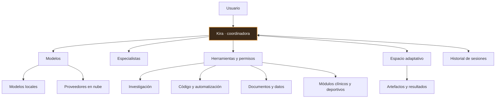
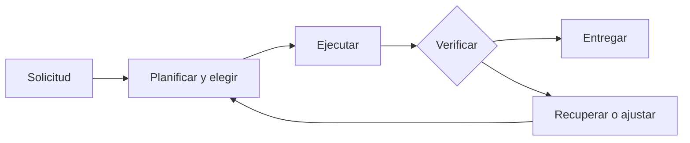

<p align="center"></p>

# PHOENIX AI Harness

[English](README.md) | Español | [中文](README.zh.md)

**Un espacio de IA de código abierto. Una experiencia, múltiples modelos.**

PHOENIX es un espacio de trabajo de agentes de IA de propósito general, orientado a la ejecución local, creado y liderado por el **Dr. Arisnachy Gómez Díaz** desde República Dominicana. Kira integra conversación, herramientas, modelos, especialistas y artefactos de trabajo en un mismo entorno. Elige el motor adecuado sin reconstruir tu flujo de trabajo alrededor de un proveedor.

**Tus modelos. Tu espacio. Tu IA.**

[](LICENSE) [](https://github.com/arisnachy/phoenix-harnes/stargazers) [](https://github.com/arisnachy/phoenix-harnes/releases) [](https://github.com/arisnachy/phoenix-harnes/releases)

[Empezar](#run) · [Versiones Windows](https://github.com/arisnachy/phoenix-harnes/releases) · [Comunidad](https://github.com/arisnachy/phoenix-harnes/discussions) · [Reportar problemas](https://github.com/arisnachy/phoenix-harnes/issues)

[](https://github.com/arisnachy/phoenix-harnes/releases/latest)

**[Descargar PHOENIX para Windows](https://github.com/arisnachy/phoenix-harnes/releases/latest)** · [Sitio oficial](https://arisnachy.github.io/phoenix-harnes/) · [Revisar script de instalación](https://github.com/arisnachy/phoenix-harnes/blob/main/install-phoenix.ps1)

Consulta la última versión publicada y sus notas antes de instalar. Para instalar desde el código fuente, consulta la sección Run. El software es gratuito bajo MIT; los servicios de modelos opcionales pueden tener costos. La firma de código de Windows sigue pendiente.

## Qué puedes hacer

| Capacidad | Qué ofrece PHOENIX |
| --- | --- |
| Kira y Living Team | Identidad persistente, colaboración con especialistas, actividad visible, respuestas y delegaciones en sesiones compatibles. |
| Libertad de modelos | Proveedores compatibles, credenciales API, conexión oficial ChatGPT/Codex cuando esté disponible, Ollama e inferencia local administrada. |
| Espacio adaptativo | Interfaz conversacional con superficies contextuales, MiniBrowser, formularios y vistas de artefactos; distribución y sincronización en evolución. |
| Documentos y datos | Trabajo con archivos, hojas de cálculo, datos estructurados, informes y artefactos generados; la compatibilidad varía por formato y editor. |
| Investigación y análisis | Descubrimiento de fuentes por dominio, investigación con citas, análisis de datos e informes; verificar fuentes y datos en vivo. |
| Desarrollo de software | Inspección de repositorios, edición de código, terminal, herramientas, pruebas y flujos Git compatibles bajo permisos configurados. |
| Memoria y continuidad | Historial persistente de sesiones, contexto y mecanismos de recuperación según el runtime instalado. |
| Healthia | Entorno clínico en desarrollo por etapas: expedientes, formularios de consulta y documentación; requiere revisión profesional. |
| Inteligencia deportiva | Investigación de datos deportivos y verificación de fuentes; cobertura y disponibilidad en vivo variables. |
| Evolución e inteligencia adaptativa | Evaluación, recuperación, selección de especialistas y experimentos de mejora acotada; sin afirmar autoentrenamiento autónomo ni rendimiento garantizado. |

## Cómo funciona PHOENIX



## De una solicitud a un resultado



## Estado del desarrollo

PHOENIX está en desarrollo activo. Los diagramas representan su arquitectura de producto, no capturas de pantalla ni certificaciones. Se incluyen componentes disponibles e integraciones en evolución; cada flujo depende de la versión, proveedor, hardware, permisos y pruebas. Healthia no se presenta como dispositivo médico certificado y el análisis deportivo no garantiza resultados. Consulta documentación y notas de versión para conocer las limitaciones.

### Documentación técnica

[Kira Teams](packages/client/ui-kira-teams/README.md) · [Contextual UI](docs/product/PHOENIX_UNIVERSAL_CONTEXTUAL_UI.md) · [Universal Intelligence](docs/phoenix-universal-intelligence-3.0.md) · [Healthia](docs/healthia-chat-first-intake-architecture.md) · [Research Studio](docs/phoenix-research-studio-2.1.md) · [Sports](docs/sports/SPORTS_SOURCE_VERIFICATION.md) · [Evolution](docs/evolution/PHOENIX_EVOLUTION_V16.md)

## Run

### Windows

Consulta [las versiones publicadas](https://github.com/arisnachy/phoenix-harnes/releases) y [la guía de instalación completa](README.md#run). Revisa los requisitos y la firma del instalador antes de ejecutarlo. Para instalar desde código fuente, utiliza Node.js 22.19 o superior:

```powershell
git clone https://github.com/arisnachy/phoenix-harnes.git
cd phoenix-harnes
.\phoenix-windows.cmd
```

Configura tus modelos en Settings → Models. Las credenciales API y el acceso oficial ChatGPT/Codex son rutas distintas. Las actualizaciones siguen el canal estable y sus controles de compilación. Consulta [la guía de Windows](docs/phoenix-windows.md) y [actualización estable](docs/evolution/PHOENIX_AUTO_UPDATE.md).

## Comunidad y desarrollo

[Contribuir](CONTRIBUTING.md) · [Arquitectura](docs/architecture.md) · [Guía de desarrollo](docs/development.md).

## Licencia y atribución de terceros

PHOENIX es la identidad del producto. Los avisos de derechos de autor existentes, incluidos los del código heredado y los componentes incorporados, se conservan en [LICENSE](LICENSE), [THIRD_PARTY_NOTICES.md](THIRD_PARTY_NOTICES.md) y [vendor/README.md](vendor/README.md). No se reclama autoría de código de terceros.
