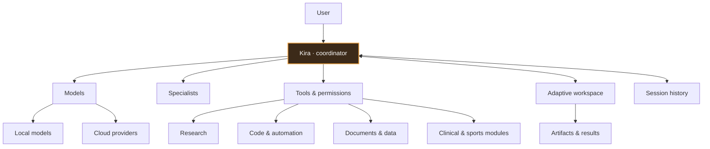
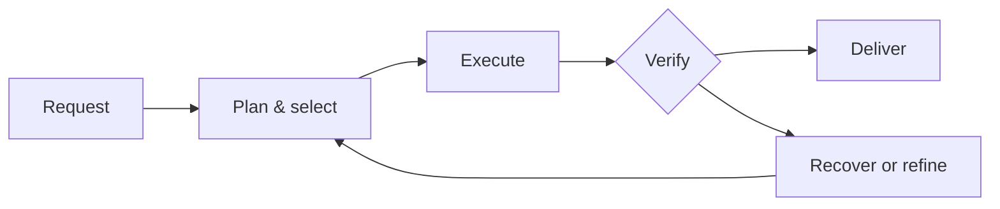

<p align="center"></p>

# PHOENIX AI Harness

English | [Español](README.es.md) | [中文](README.zh.md)

**An open-source AI workspace. One agent experience, many models.**

PHOENIX is a general-purpose, local-first AI agent workspace created and led by **Dr. Arisnachy Gómez Díaz** in the Dominican Republic. Kira brings conversation, tools, models, specialist agents and working artifacts into a single environment. Choose the AI engine that fits the task rather than rebuilding your workflow around a provider.

**Your models. Your workspace. Your AI.**

[](LICENSE) [](https://github.com/arisnachy/phoenix-harnes/stargazers) [](https://github.com/arisnachy/phoenix-harnes/releases) [](https://github.com/arisnachy/phoenix-harnes/releases)

[Get started](#run) · [Windows releases](https://github.com/arisnachy/phoenix-harnes/releases) · [Community](https://github.com/arisnachy/phoenix-harnes/discussions) · [Report an issue](https://github.com/arisnachy/phoenix-harnes/issues)

[](https://github.com/arisnachy/phoenix-harnes/releases/latest)

**[Download PHOENIX for Windows](https://github.com/arisnachy/phoenix-harnes/releases/latest)** · [Official website](https://arisnachy.github.io/phoenix-harnes/) · [Inspect installation script](https://github.com/arisnachy/phoenix-harnes/blob/main/install-phoenix.ps1)

Prefer the latest published release and read its notes before installing. For a source-based installation, see the Run section below. The software is free under MIT; optional model services may charge separately. Windows code signing is still a release gate.

**Like PHOENIX?** If it is useful to you, [star the project on GitHub](https://github.com/arisnachy/phoenix-harnes) to follow its development and help other developers discover it. [Share feedback or report an issue](https://github.com/arisnachy/phoenix-harnes/issues) after trying it.

## Try PHOENIX with a real task

1. [Get the latest published Windows release](https://github.com/arisnachy/phoenix-harnes/releases/latest) or [run from source](#run).
2. In **Settings → Models**, configure an available local or cloud model. Free-tier availability and local hardware requirements vary.
3. Start a conversation with Kira and try one of these prompts:

| Your goal | Example prompt |
| --- | --- |
| Understand a codebase | Inspect this repository, explain its architecture, and suggest a small improvement with a test plan. |
| Analyze your data | Review this CSV, identify missing values, summarize the results, and propose a chart. |
| Research a topic | Compare three approaches to this problem, cite your sources, and flag uncertain claims. |
| Try local AI | Use my configured local model to summarize this sample document. Tell me if a tool or capability is unavailable. |

Start with non-sensitive sample data and review tool permissions before approving changes. These are suggested workflows, not benchmark results or guarantees; availability depends on your installed release and model.

**Help improve PHOENIX:** [report your first-run experience](https://github.com/arisnachy/phoenix-harnes/issues/new/choose), including the release, model/provider and what worked or failed. Remove credentials and private data before posting. If PHOENIX earned a place in your toolkit, [give it a star](https://github.com/arisnachy/phoenix-harnes) or share it with someone who could use it.

## What you can do

| Capability | What PHOENIX provides |
| --- | --- |
| Kira & Living Team | A persistent agent identity, specialist collaboration, visible activity, replies and handoffs within supported sessions. |
| Model freedom | Supported cloud providers, API credentials, official ChatGPT/Codex account connection when available, Ollama and managed local inference. |
| Adaptive workspace | A conversational interface with contextual surfaces, MiniBrowser, forms and artifact previews; layout and synchronization are evolving. |
| Documents & data | Work with files, spreadsheets, structured data, reports and generated artifacts; format and editing support varies by surface. |
| Research & analysis | Domain-aware source discovery, cited research workflows, data analysis and report preparation; verify sources and live data. |
| Software development | Repository inspection, code editing, terminal and tool execution, tests and supported Git workflows under configured permissions. |
| Memory & continuity | Durable session history, context and recovery mechanisms; availability depends on the installed runtime. |
| Healthia | Clinical workspace under staged development: patient records, consultation forms and clinical documentation; clinician review required. |
| Sports intelligence | Research and source-verification workflows for sports data; coverage and live availability vary. |
| Evolution & adaptive intelligence | Evaluation, recovery, specialist selection and bounded improvement experiments; no claim of autonomous self-training or guaranteed performance. |

## How PHOENIX works



## From a request to a deliverable



## Development status

PHOENIX is actively developed. The diagrams describe the product architecture, not a screenshot or a certification. The features above include available components and ongoing integrations; individual workflows depend on the build, provider, hardware, permissions and tests. Healthia is not presented as a certified medical device, and sports analysis does not guarantee outcomes. See the repository documentation and release notes for current limitations.

### Explore the technical documentation

[Kira Teams](packages/client/ui-kira-teams/README.md) · [Contextual UI](docs/product/PHOENIX_UNIVERSAL_CONTEXTUAL_UI.md) · [Universal Intelligence](docs/phoenix-universal-intelligence-3.0.md) · [Healthia](docs/healthia-chat-first-intake-architecture.md) · [Research Studio](docs/phoenix-research-studio-2.1.md) · [Sports](docs/sports/SPORTS_SOURCE_VERIFICATION.md) · [Evolution](docs/evolution/PHOENIX_EVOLUTION_V16.md)

## Run

### One-line Windows install

Open PowerShell and run:

```powershell
irm https://raw.githubusercontent.com/arisnachy/phoenix-harnes/main/install-phoenix.ps1 | iex
```

The bootstrap installs missing Node.js/Git through `winget`, clones or fast-forwards the dedicated PHOENIX installation, performs an immutable dependency install and build, and creates **PHOENIX HARDNESS** shortcuts in the Start menu, Windows startup, and the taskbar shortcut store. Windows versions without a localized pin action still receive a taskbar-ready shortcut; pin it once from the shortcut context menu. Use `-NoStartup` or `-NoTaskbar` to opt out. Managed installations check the promoted `stable` branch at launch and apply only clean, preflighted updates; a clean managed release checkout may also safely replace unrelated legacy history while retaining a recovery ref. Set `PHOENIX_AUTO_UPDATE=0` to disable that check. Local changes are preserved instead of overwritten. The script is not a signed MSIX; code signing remains a release gate until a project certificate is configured.

### VS Code and Cursor

Build the installable extension with `pnpm --dir apps/vscode run package:vsix`, then install `dist/phoenix-hardness-vscode.vsix` from **Extensions → Install from VSIX**. Its Explorer panel starts the local PHOENIX runtime and opens the Web UI without reading model credentials.

### Run from source

Install Node.js 22.19 or newer, then:

```powershell
git clone https://github.com/arisnachy/phoenix-harnes.git
cd phoenix-harnes
.\phoenix-windows.cmd
```

`phoenix-windows.cmd` changes to its own repository directory, uses the Corepack copy included with Node.js to prepare dependencies, builds PHOENIX when needed, and starts the local Web UI. A global `pnpm` installation is not required.

### Stable automatic updates

PHOENIX source installations follow the repository's stable update channel. A new `main` commit is published to clients only after the current `main` CI succeeds. Running installations detect the new stable commit and, by default, install it after the active PHOENIX session closes; Windows also checks the stable channel before the next launch.

Automatic installation requires an official `origin`, branch `main` or `stable`, a clean worktree, a successful isolated preflight build, and a recovery checkpoint. A locally modified checkout may still prepare and validate a candidate in detached staging, but it is never overwritten or activated until clean. Fast-forward releases use `git merge --ff-only`; managed release checkouts with unrelated legacy history use a guarded `git reset --hard` after preflight. A failed live update rolls back to the previous known-good commit. Development branches and locally modified checkouts are never overwritten automatically, and the updater never mutates PHOENIX user data, credentials, sessions, memories, or projects.

Set `PHOENIX_UPDATE_MODE=notify` for notifications without installation or `PHOENIX_UPDATE_MODE=off` to disable checking. See [PHOENIX Stable Auto-Update](docs/evolution/PHOENIX_AUTO_UPDATE.md) for the complete release, recovery, and trust contract.

Codex plugin and OpenClaw skill updates use the isolated [upstream intake](docs/evolution/PHOENIX_UPSTREAM_INTAKE.md), which stages and verifies candidates before changing initialized bridges.

### Configure OpenRouter on Windows

PHOENIX starts with the `openrouter/free` model route selected. Create an [OpenRouter API key](https://openrouter.ai/settings/keys), then configure it inside PHOENIX:

1. Open **Settings → Models → OpenRouter**.
2. Paste the key and save it. The key is written to the local PHOENIX credential store and is not committed to Git.
3. Use the model selector in the composer to switch from `openrouter/free` to another OpenRouter model.

The provider, key, endpoint, model catalog, and active model are managed from the Web UI. Free models are intended for testing and remain subject to OpenRouter availability and rate limits.

### Use Google Gemini inside Kira (independent provider)

PHOENIX includes the `google` model route through the existing `llm-pi-ai` adapter. Pick a supported Gemini model from the normal chat model selector; Kira retains the PHOENIX conversation history, shared tool pipeline, approvals, voice/UI integration, and model-independent features. This route does **not** use Codex's Eclipse router or Google Workspace OAuth permissions.

1. Generate a **Gemini API key** in [Google AI Studio](https://aistudio.google.com/apikey), choosing a project with no billing enabled if you want Google's eligible free-tier limits only.
2. Open **Settings → Models → Google** in PHOENIX, add the Gemini key using the secure credential interface (or configure `GEMINI_API_KEY` in the host environment), and save.
3. Use the chat composer model selector to choose `google` and a model from the adapter's installed catalog. The actual supported models and quotas depend on the provider and account; a catalog entry is not proof that a given account may use that model.

A Google/Antigravity **personal account subscription** is not interchangeable with a Gemini Developer API credential: Google's consumer terms disallow wrapping `agy -p` or its account OAuth to provide models to arbitrary third-party agents such as PHOENIX. PHOENIX does not import Antigravity account tokens, bypass product restrictions, or silently switch to paid billing. For development-focused editor ACP integration, use the separately documented Google-supported `agy acp` protocol in an eligible editor context.

### Connect ChatGPT / Codex

PHOENIX keeps OpenAI API-key authentication separate from ChatGPT subscription authentication. The native Codex bridge uses the official Codex app-server managed ChatGPT login, so Codex owns OAuth persistence and token refresh. PHOENIX does not ask for a ChatGPT password and does not parse, copy, or persist ChatGPT OAuth tokens.

When the native Codex bridge is mounted, **Settings → Models → Account connections** offers **ChatGPT / Codex** sign-in. The same native account plane can read the active ChatGPT plan, Codex rate-limit windows, reset times, and account token-activity data without routing the subscription through the generic `pi-ai` OAuth adapter.

## Community and support

Use this repository's [Issues](https://github.com/arisnachy/phoenix-harnes/issues) and [Discussions](https://github.com/arisnachy/phoenix-harnes/discussions) for PHOENIX feedback, bugs, design discussion, and support.

## Contributing

See [CONTRIBUTING.md](CONTRIBUTING.md).

## Development

Start with the [development guide](docs/development.md) and [architecture documentation](docs/architecture.md). PHOENIX capabilities are integrated through staged, independently verified branches and pull requests so the stable base stays auditable.

Windows installation, IDE packaging, native sandbox boundaries, and continuity status are documented in [PHOENIX on Windows](docs/phoenix-windows.md).

For agents, follow [AGENTS.md](AGENTS.md).

## License and third-party attribution

PHOENIX is the product identity. Existing copyright notices, including those for inherited and vendored code, remain in [LICENSE](LICENSE), [THIRD_PARTY_NOTICES.md](THIRD_PARTY_NOTICES.md) and [vendor/README.md](vendor/README.md). No authorship of third-party code is claimed.
