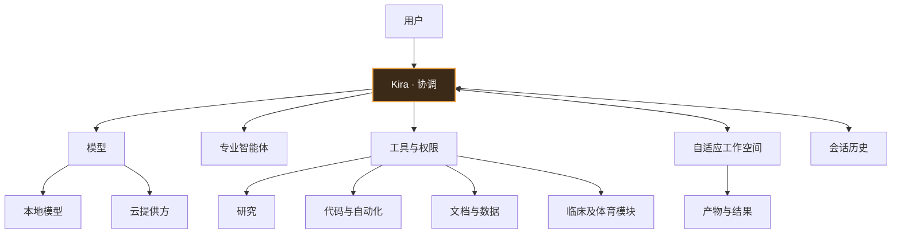
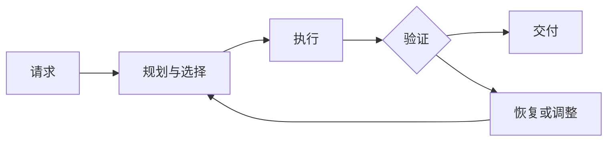

<p align="center"></p>

# PHOENIX AI Harness

[English](README.md) | [Español](README.es.md) | 中文

**开源 AI 工作空间：统一的智能体体验，多种模型选择。**

PHOENIX 是由多米尼加共和国的 **Arisnachy Gómez Díaz 博士** 创建并领导的通用、本地优先 AI 智能体工作空间。Kira 将对话、工具、模型、专业智能体与工作产物整合到同一个环境。用户可以选择适合任务的 AI 引擎，而不必围绕某个提供方重建工作流程。

**你的模型，你的工作空间，你的 AI。**

[](LICENSE) [](https://github.com/arisnachy/phoenix-harnes/stargazers) [](https://github.com/arisnachy/phoenix-harnes/releases) [](https://github.com/arisnachy/phoenix-harnes/releases)

[开始使用](#run) · [Windows 版本](https://github.com/arisnachy/phoenix-harnes/releases) · [社区](https://github.com/arisnachy/phoenix-harnes/discussions) · [报告问题](https://github.com/arisnachy/phoenix-harnes/issues)

[](https://github.com/arisnachy/phoenix-harnes/releases/latest)

**[下载 PHOENIX Windows 版](https://github.com/arisnachy/phoenix-harnes/releases/latest)** · [官方网站](https://arisnachy.github.io/phoenix-harnes/) · [查看安装脚本](https://github.com/arisnachy/phoenix-harnes/blob/main/install-phoenix.ps1)

安装前请查看最新发布版本及其说明。源码安装请参阅下方 Run 章节。软件采用 MIT 许可免费提供；可选的模型服务可能收费。Windows 代码签名仍是发布前的待完成事项。

**觉得 PHOENIX 有用？** 欢迎[在 GitHub 上为项目加星](https://github.com/arisnachy/phoenix-harnes)，关注项目进展并帮助其他开发者发现它。试用后也欢迎[提交反馈或报告问题](https://github.com/arisnachy/phoenix-harnes/issues)。

## 你可以做什么

| 能力 | PHOENIX 提供的功能 |
| --- | --- |
| Kira 与 Living Team | 在受支持的会话中保持智能体身份、协作、可见活动、回复和任务交接。 |
| 模型自由 | 受支持的云服务商、API 凭据、可用时的官方 ChatGPT/Codex 账户连接、Ollama 与受管理本地推理。 |
| 自适应工作空间 | 对话界面结合上下文界面、MiniBrowser、表单与产物预览；布局与同步仍在完善。 |
| 文档与数据 | 处理文件、电子表格、结构化数据、报告和生成产物；格式与编辑能力因界面而异。 |
| 研究与分析 | 按领域发现来源、带引用的研究工作流、数据分析及报告准备；需核实来源和实时数据。 |
| 软件开发 | 在配置权限下检查仓库、编辑代码、执行终端与工具、运行测试及受支持的 Git 流程。 |
| 记忆与连续性 | 持久会话历史、上下文和恢复机制；可用性取决于安装的运行时。 |
| Healthia | 分阶段开发中的临床工作空间：患者记录、就诊表单和临床文档；需要专业人员审核。 |
| 体育智能 | 体育数据研究与来源验证；覆盖范围与实时可用性会变化。 |
| 演进与自适应智能 | 评估、恢复、专业智能体选择和有边界的改进实验；不宣称自主训练或保证性能。 |

## PHOENIX 如何工作



## 从请求到交付



## 开发状态

PHOENIX 正在积极开发。图示描述产品架构，并非界面截图或认证。以上包含可用组件与持续完善的集成；各流程取决于版本、提供方、硬件、权限和测试。Healthia 不作为已认证医疗器械宣传，体育分析不保证结果。请查看文档和发布说明了解当前限制。

### 技术文档

[Kira Teams](packages/client/ui-kira-teams/README.md) · [Contextual UI](docs/product/PHOENIX_UNIVERSAL_CONTEXTUAL_UI.md) · [Universal Intelligence](docs/phoenix-universal-intelligence-3.0.md) · [Healthia](docs/healthia-chat-first-intake-architecture.md) · [Research Studio](docs/phoenix-research-studio-2.1.md) · [Sports](docs/sports/SPORTS_SOURCE_VERIFICATION.md) · [Evolution](docs/evolution/PHOENIX_EVOLUTION_V16.md)

## Run

### Windows 单行安装

打开 PowerShell 并执行：

```powershell
irm https://raw.githubusercontent.com/arisnachy/phoenix-harnes/main/install-phoenix.ps1 | iex
```

该引导程序会通过 `winget` 安装缺失的 Node.js/Git，克隆或快进专用 PHOENIX 安装目录，执行不可变依赖安装与构建，并在开始菜单、Windows 启动文件夹和任务栏快捷方式存储位置创建 **PHOENIX HARDNESS** 快捷方式。如果 Windows 版本没有本地化的固定到任务栏操作，仍会创建可用于任务栏的快捷方式；从快捷方式上下文菜单固定一次即可。使用 `-NoStartup` 或 `-NoTaskbar` 可选择退出。受管安装会在启动时检查已晋升的 `stable` branch，并且只应用干净且通过 preflight 的更新；带有管理标记的干净发布 checkout 也可以在保留 recovery ref 的前提下安全替换不相关的旧历史；设置 `PHOENIX_AUTO_UPDATE=0` 可以禁用该检查。本地修改会被保留而不是覆盖。此脚本不是已签名的 MSIX；在配置项目证书之前，代码签名仍是发布 gate。

### VS Code 与 Cursor

使用 `pnpm --dir apps/vscode run package:vsix` 构建可安装扩展，然后在**扩展 → 从 VSIX 安装**中安装 `dist/phoenix-hardness-vscode.vsix`。其 Explorer 面板可以启动本地 PHOENIX 运行时并打开 Web UI，而且不会读取模型凭据。

### Run from source

安装 Node.js 22.19 或更高版本，然后执行：

```powershell
git clone https://github.com/arisnachy/phoenix-harnes.git
cd phoenix-harnes
.\phoenix-windows.cmd
```

`phoenix-windows.cmd` 会自动进入自身所在的仓库目录，使用 Node.js 内置的 Corepack 准备依赖，在需要时构建 PHOENIX，并启动本地 Web UI。不需要全局安装 `pnpm`。

### 稳定自动更新

PHOENIX 源码安装遵循仓库的稳定更新通道。新的 `main` commit 只有在当前 `main` 的 CI 成功后才会发布给客户端。运行中的安装会检测新的稳定 commit，并默认在活跃的 PHOENIX session 关闭后安装；Windows 也会在下一次启动前检查稳定通道。

自动安装要求官方 `origin`、`main` 或 `stable` branch、干净的 worktree、成功的隔离 preflight build，以及 recovery checkpoint。Fast-forward release 使用 `git merge --ff-only`；具有不相关旧历史的受管发布 checkout 会在 preflight 后使用受保护的 `git reset --hard`。实时更新失败时会 rollback 到之前的已知良好 commit。Development branches 和本地修改过的 checkout 永远不会被自动覆盖，而且 updater 永远不会修改 PHOENIX 用户数据、credentials、sessions、memories 或 projects。

设置 `PHOENIX_UPDATE_MODE=notify` 可只接收通知而不安装，设置 `PHOENIX_UPDATE_MODE=off` 可禁用检查。完整的 release、recovery 与 trust contract 参见 [PHOENIX 稳定自动更新](docs/evolution/PHOENIX_AUTO_UPDATE.zh.md)。

Codex plugin 与 OpenClaw skill 更新使用隔离的 [upstream intake](docs/evolution/PHOENIX_UPSTREAM_INTAKE.zh.md)，在修改已初始化的 bridges 前会先暂存并验证 candidate。

### 在 Windows 上配置 OpenRouter

PHOENIX 默认选择 `openrouter/free` 模型路由。创建一个 [OpenRouter API 密钥](https://openrouter.ai/settings/keys)，然后在 PHOENIX 内完成配置：

1. 打开**设置 → 模型 → OpenRouter**。
2. 粘贴密钥并保存。密钥写入 PHOENIX 的本地凭据存储，不会提交到 Git。
3. 使用输入框中的模型选择器，从 `openrouter/free` 切换到其他 OpenRouter 模型。

提供方、密钥、端点、模型目录和当前模型都通过 Web UI 管理。免费模型适合测试，但仍受 OpenRouter 的可用性与速率限制约束。

### 连接 ChatGPT / Codex

PHOENIX 将 OpenAI API-key 身份验证与 ChatGPT subscription 身份验证严格分开。原生 Codex bridge 使用官方 Codex app-server 管理的 ChatGPT login，因此 OAuth persistence 与 token refresh 由 Codex 自己负责。PHOENIX 不会索取 ChatGPT password，也不会解析、复制或持久化 ChatGPT OAuth tokens。

挂载原生 Codex bridge 后，**设置 → 模型 → 账户连接**会提供 **ChatGPT / Codex** 登录。同一个原生 account plane 可以读取当前 ChatGPT plan、Codex rate-limit windows、reset times 与 account token-activity data，而无需通过通用 `pi-ai` OAuth adapter 路由 subscription。

## 社区与支持

PHOENIX 的反馈、缺陷、设计讨论和支持请使用本仓库的 [Issues](https://github.com/arisnachy/phoenix-harnes/issues) 与 [Discussions](https://github.com/arisnachy/phoenix-harnes/discussions)。

## 参与贡献

参见 [CONTRIBUTING.zh.md](CONTRIBUTING.zh.md)。

## 开发

请先阅读[开发指南](docs/development.zh.md)与[架构文档](docs/architecture.zh.md)。PHOENIX 能力会通过分阶段、独立验证的 branch 与 pull request 集成，使稳定基础始终保持可审计。

Windows 安装、IDE 打包、原生 sandbox 边界与 continuity 状态参见 [Windows 上的 PHOENIX](docs/phoenix-windows.zh.md)。

面向 agent：请遵循 [AGENTS.md](AGENTS.md)。

## 许可证与第三方署名

PHOENIX 是产品身份。现有版权声明，包括继承代码和内置第三方代码的声明，保留于 [LICENSE](LICENSE)、[THIRD_PARTY_NOTICES.md](THIRD_PARTY_NOTICES.md) 与 [vendor/README.md](vendor/README.md)。不主张第三方代码的作者身份。
